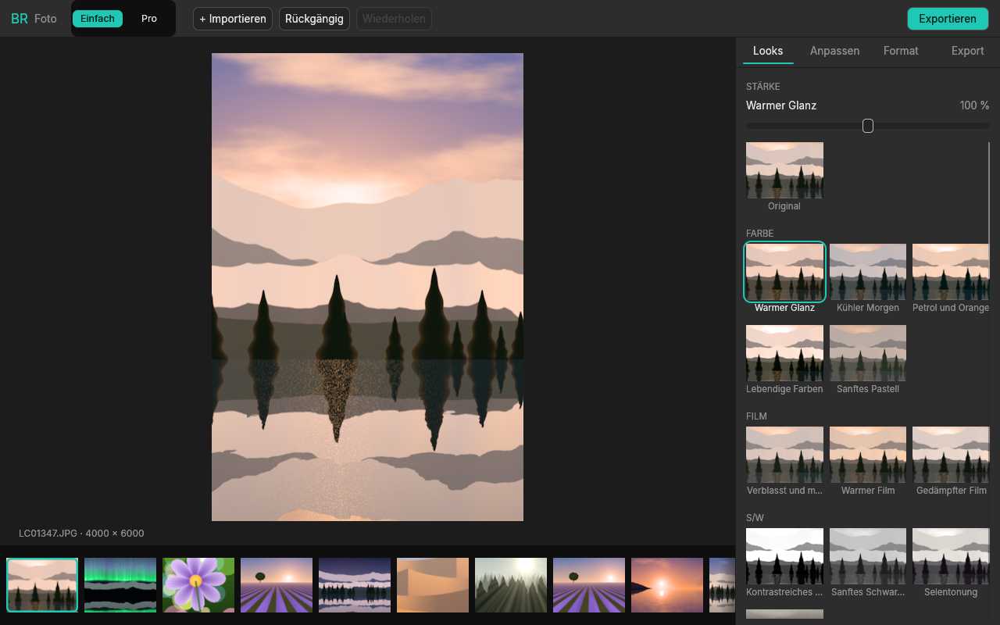

# BR

**Eine Media-Suite für Foto, Video und Motion Graphics: so einfach wie CapCut, mit den Profi-Werkzeugen
einen Klick entfernt, und komplett steuerbar durch Claude.**

BR baut auf den quelloffenen [Crafting Apps](https://getartcraft.com/apps) von ArtCraft auf (alle in Rust,
MIT/Apache-2.0): [LightCraft](https://github.com/storytold/lightcraft) für Fotos,
[FilmCraft](https://github.com/storytold/filmcraft) für Video und
[EffectCraft](https://github.com/storytold/effectcraft) für Motion Graphics. Diese Apps bilden Lightroom,
Premiere und After Effects nach, mit deren komplexen Oberflächen. BR legt eine einfache Oberfläche darüber
und gibt Claude einen MCP-Server, über den es alles bedienen kann.

## Stand: Meilenstein 1, BR Foto

BR Foto ist ein einfacher Foto-Editor auf LightCraft. Er hat zwei Modi in einem Fenster, die dieselbe
Bibliothek und dasselbe Foto teilen:

- **Einfach**
  - **Looks:** 41 Filter mit Vorschaubildern und einem Stärke-Regler (0–200 %). Ein Look ist immer genau
    ein Rückgängig-Schritt.
  - **Anpassen:** sechs Regler (Licht, Kontrast, Farbe, Wärme, Schärfe, Vignette) und *Auto*.
  - **Format:** 1:1, 4:5, 9:16, 16:9, auf ganze Pixel genau zugeschnitten.
  - **Export:** Instagram (1080 × 1350), Story/TikTok/Reels (1080 × 1920), Quadrat, Breitbild und
    volle Auflösung. Die Größen sind exakt, und die Bearbeitung des Fotos bleibt dabei unverändert.
- **Pro:** die komplette LightCraft-Oberfläche (auf Deutsch) mit RAW-Entwicklung, Masken, Kurven,
  Bibliothek und Alben.



## Für Claude: `br mcp`

```sh
claude mcp add br -- /pfad/zu/br mcp                 # Fotos im Speicher (zuerst importieren)
claude mcp add br -- /pfad/zu/br mcp --library ~/Pictures/BR\ Library
```

**BR-Werkzeuge** (`br_*`), die zuerst gelistet werden: `br_state`, `br_looks`, `br_look`, `br_adjust`,
`br_auto`, `br_crop`, `br_export`, `br_preview` (gibt ein Bild zurück), `br_reset`, `br_undo`, `br_redo`.

Dahinter stehen alle Werkzeuge von LightCraft (`import`, `query_photos`, `set_develop`, `render_photo`,
`command_run`, …). Mit `--full` kommt jeder einzelne LightCraft-Befehl als eigenes Werkzeug dazu
(etwa 330). Das Repo enthält eine fertige [`.mcp.json`](.mcp.json).

> Eine Bibliothek kann immer nur ein Programm gleichzeitig öffnen. Solange das BR-Fenster sie geöffnet
> hat, arbeitet `br mcp` im Speicher oder mit einer anderen Bibliothek.

## Kommandozeile

```sh
br                                   # Fenster (Bibliothek: ~/Pictures/BR Library)
br --demo                            # Fenster mit LightCraft's 24 Demo-Fotos
br photo urlaub.jpg --look "Golden Hour:70" --light 10 --preset instagram -o insta.jpg
br run --demo br.look look=lc.moody br.crop format=9:16 br.export preset=story dir=out
br looks                             # alle Looks
br commands                          # die br.*-Befehle
br snapshot --demo --page farbe -o shot.png   # Fenster ohne Bildschirm als PNG
br mcp --demo                        # MCP-Server
```

## Aufbau

| Crate | Inhalt |
|---|---|
| `crates/br-photo` | Die einfache Bearbeitung: Looks, Regler, Formate, Export-Vorlagen und die `br.*`-Befehle. Wird von Fenster, CLI und MCP gemeinsam genutzt. |
| `crates/br-mcp` | Der MCP-Server: der von LightCraft, mit BRs `br_*`-Werkzeugen davor. |
| `crates/br-ui` | Das Fenster: der einfache Modus, LightCraft als Pro-Modus und ein Headless-Treiber für Screenshots und Tests. |
| `apps/br` | Das Programm `br`. |

LightCraft wird als Git-Abhängigkeit eingebunden, fest auf einen Commit gesetzt (`Cargo.toml`). Ein Update
heißt: den Commit hochsetzen und die Tests laufen lassen.

## Bauen und testen

Voraussetzung ist Rust 1.95 oder neuer. Weitere Systembibliotheken braucht der Build nicht. Auf Linux braucht
das Fenster zur Laufzeit die üblichen X11/Wayland-Bibliotheken (`libxkbcommon-x11`, Mesa).

```sh
cargo run --release -p br -- --demo
cargo test --workspace               # läuft ohne Bildschirm und ohne GPU
```

Das Fenster nutzt wgpu (Vulkan, Metal oder DX12). Startet das nicht, startet BR von selbst neu, dann mit
OpenGL (glow). Mit `BR_RENDERER=glow` oder `BR_RENDERER=wgpu` lässt sich der Renderer erzwingen. Unter
Linux nutzt BR X11 (XWayland), weil winit nur dort Dateien per Drag-and-drop annimmt; `BR_WAYLAND=1`
bleibt bei nativem Wayland.

## Nächste Schritte

- **Video:** FilmCraft im selben Muster einbinden, also einen einfachen Schnitt-Modus mit FilmCraft als Pro-Modus.
- **Motion Graphics:** EffectCraft für Titel, Animationen und Vorlagen.
- `br mcp --connect`: Claude steuert das laufende Fenster, so wie es LightCraft mit `--control` macht.

## Lizenz

MIT oder Apache-2.0, nach Wahl. LightCraft, FilmCraft und EffectCraft sind Projekte des ArtCraft-Teams unter
denselben Lizenzen. Ihre Namen und Logos sind Marken von ArtCraft und gehören nicht zu BR.
