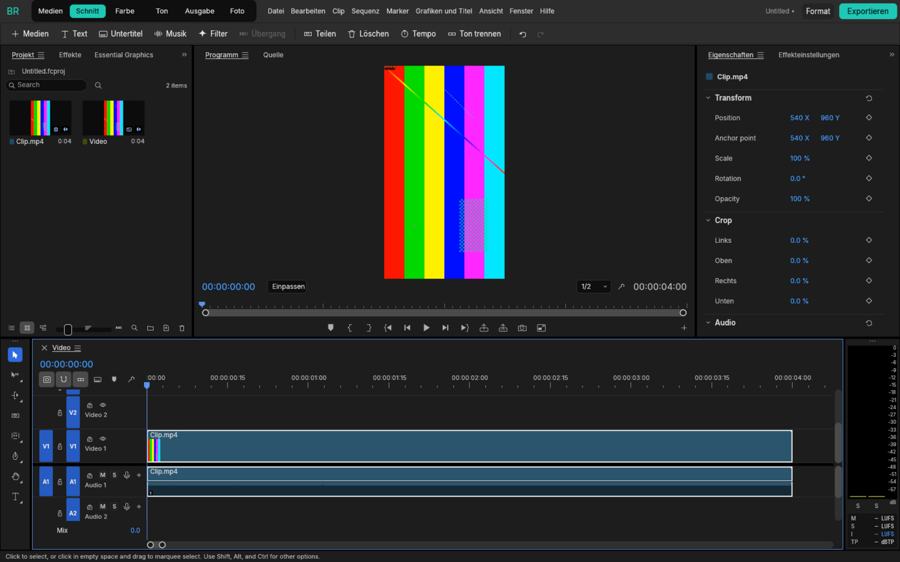
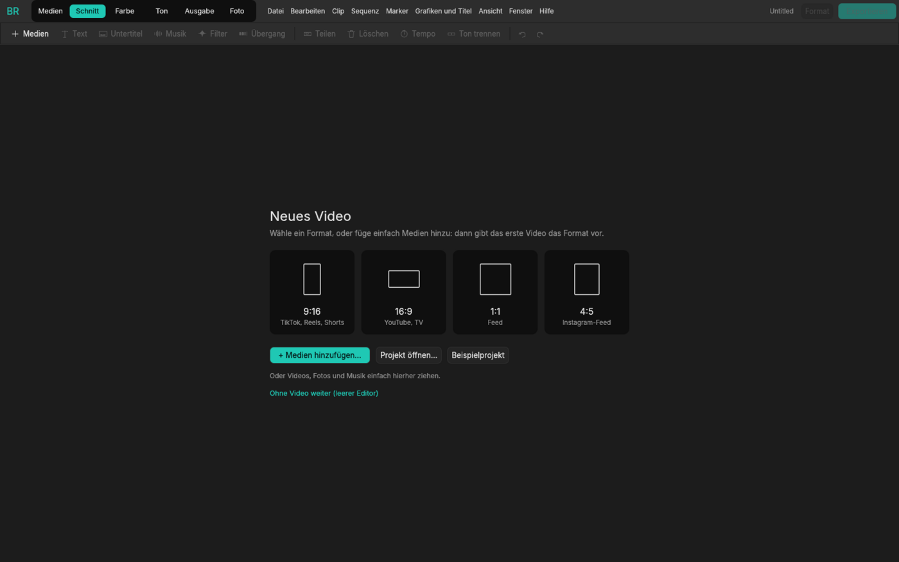
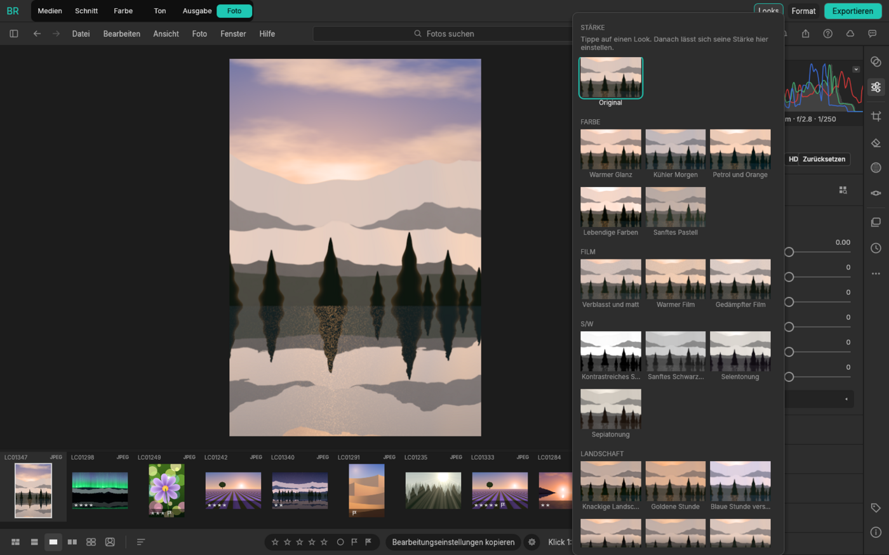

# BR

**Eine Media-Suite für Foto und Video: der Funktionsumfang von DaVinci Resolve, so direkt bedienbar wie
CapCut, und komplett steuerbar durch Claude.**

BR baut auf den quelloffenen [Crafting Apps](https://getartcraft.com/apps) von ArtCraft auf (alle in Rust,
MIT/Apache-2.0): [FilmCraft](https://github.com/storytold/filmcraft) (ein Premiere-Nachbau) für Video und
[LightCraft](https://github.com/storytold/lightcraft) (ein Lightroom-Nachbau) für Fotos. Beide stecken
vollständig in BR, mit allen Panels, Menüs, Tastenkürzeln und Einstellungen. Nichts ist weggelassen oder
vereinfacht. BR ordnet sie in Seiten wie DaVinci Resolve und legt CapCuts Bedienung darüber: Werkzeuge,
die mit einem Klick zum Ergebnis führen, und hinter jedem davon das volle Werkzeug.

## Seiten

| Seite | Was | Darunter |
|---|---|---|
| **Medien** | Medien sichten, importieren, ordnen | FilmCrafts Import-Modus |
| **Schnitt** | Schneiden in CapCuts Anordnung: Medien, Effekte und Texte links, Bild in der Mitte, Eigenschaften rechts, Timeline unten | FilmCraft |
| **Farbe** | Farbkorrektur und Looks mit Scopes | Lumetri (FilmCraft) |
| **Ton** | Mischpult, Pegel, Sprache, Musik, Effekte | Essential Sound, Mixer (FilmCraft) |
| **Ausgabe** | Exportieren: Formate, Bereich, Warteschlange | FilmCrafts Export-Modus |
| **Foto** | Bibliothek, RAW-Entwicklung, Masken, Kurven, Looks | LightCraft |

Jede Seite behält das Layout, das man ihr gibt. FilmCrafts Menüleiste steht in BRs Kopfzeile, und jedes
Panel lässt sich über „Fenster“ auf jede Seite holen. Tastenkürzel gehen an die App der sichtbaren Seite.



### Schnitt wie in CapCut

- **Startbildschirm** für ein neues Projekt: Format-Kacheln (9:16, 16:9, 1:1, 4:5), „Medien hinzufügen“,
  Projekt öffnen, Beispielprojekt, zuletzt geöffnete Projekte. Hineingezogene Dateien werden direkt zum
  Video, und das erste Video gibt das Format vor.
- **Werkzeugleiste** über dem Editor: Medien, Text, Untertitel, Musik, Filter, Übergang | Teilen, Löschen,
  Tempo, Ton trennen | Rückgängig, Wiederholen. Jedes Werkzeug ist ein einziger Rückgängig-Schritt.
- **Untertitel automatisch** aus der Sprache: Whisper läuft auf dem eigenen Rechner, im Hintergrund mit
  Fortschritt und Abbrechen. Das Sprachmodell (etwa 150 MB) wird beim ersten Mal geladen.
- **Musik** kommt als eigene Spur unter das Video, genauso lang wie das Video und unter Sprache automatisch
  leiser.
- **Format** (oben rechts): Das Video wird in ein anderes Seitenverhältnis gebracht, die Clips eingepasst
  oder füllend.
- **Exportieren** (oben rechts) mit Vorlagen für TikTok/Reels/Shorts (1080 × 1920), YouTube 1080p und 4K,
  „wie das Video“ und ProRes 422 HQ. Der Export läuft im Hintergrund, mit Fortschritt.



Auf der Foto-Seite gibt es dasselbe für Bilder: Looks mit Stärke-Regler, Formate auf den Pixel genau und
Export-Vorlagen (Instagram, Story, Quadrat, Breitbild, volle Auflösung).



## Für Claude: `br mcp`

```sh
claude mcp add br -- /pfad/zu/br mcp                 # eigenes Projekt im Speicher
claude mcp add br -- /pfad/zu/br mcp --connect       # im laufenden Fenster (br --control)
```

- **Video** (`br_video_*`): `br_video_add`, `br_video_new`, `br_video_split`, `br_video_delete`,
  `br_video_speed`, `br_video_detach_audio`, `br_video_text`, `br_video_auto_captions`,
  `br_video_captions`, `br_video_music`, `br_video_looks`, `br_video_filter`, `br_video_format`,
  `br_video_transition`, `br_video_preview` (gibt ein Bild zurück), `br_video_export`, `br_video_state`,
  `br_video_undo`, `br_video_redo`. Lange Arbeit (Untertitel, Export eines langen Videos) läuft mit
  `wait: false` im Hintergrund; `br_video_jobs` zeigt den Fortschritt, `br_video_cancel` bricht ab.
- **Der ganze FilmCraft:** `film_commands` sucht unter seinen über 300 Befehlen (Timeline, Lumetri,
  Keyframes, Essential Sound, Untertitel, Export-Einstellungen …), `film_run` führt jeden davon aus.
- **Fotos** (`br_*`): `br_looks`, `br_look`, `br_adjust`, `br_auto`, `br_crop`, `br_export`, `br_preview`,
  `br_state`, `br_reset`, `br_undo`, `br_redo`, dahinter alle Werkzeuge von LightCraft (`import`,
  `query_photos`, `set_develop`, `command_run` …). Mit `--full` kommt jeder LightCraft-Befehl als eigenes
  Werkzeug dazu.

**Im laufenden Fenster:** Mit `br --control` (oder `BR_CONTROL=1`) öffnet BR einen Steuerkanal auf
127.0.0.1. Dann arbeitet `br mcp --connect` in dem Fenster, das man sieht: Claude schneidet, und man schaut
zu. Den Kanal schützt ein Token, das BR bei jedem Start neu erzeugt und nur für den eigenen Benutzer lesbar
ablegt (`control.json` im Einstellungsordner). Ohne dieses Token wird keine Anfrage ausgeführt.

Das Repo enthält eine fertige [`.mcp.json`](.mcp.json).

## Kommandozeile

```sh
br                                   # Fenster (startet auf „Schnitt“)
br clip.mp4 musik.mp3                # Fenster mit einem Video aus diesen Dateien
br --demo urlaub.jpg                 # Fotos öffnen die Foto-Seite
br --control                         # mit Steuerkanal für `br mcp --connect`
br run --import clip.mp4 br.video.split seconds=2 br.video.text text=Hallo \
       br.video.export preset=social path=reel.mp4 wait=true
br run film.sequence.inspect         # jeder FilmCraft-Befehl als film.<id>
br photo urlaub.jpg --look "Golden Hour:70" --light 10 --preset instagram -o insta.jpg
br commands [--film]                 # BRs Befehle (--film: alle von FilmCraft)
br snapshot --page farbe -o shot.png # Fenster ohne Bildschirm als PNG
```

## Im Browser

`deploy/browser` macht aus einem Linux-Server einen BR, der im Browser läuft. Fotos und Videos werden auf
der Seite hochgeladen, die Exporte dort heruntergeladen. Das Ganze steht hinter einem Login, und Claude
kann im selben Fenster mitarbeiten. Siehe [deploy/browser/README.md](deploy/browser/README.md).

## Aufbau

| Crate | Inhalt |
|---|---|
| `crates/br-video` | BRs Video-Befehle (`br.video.*`) auf FilmCrafts Engine, jeder ein Rückgängig-Schritt; Auto-Untertitel im Hintergrund. Gemeinsam genutzt von Fenster, CLI und MCP. |
| `crates/br-photo` | Dasselbe für Fotos (`br.*`) auf LightCraft: Looks, Regler, Formate, Export-Vorlagen. |
| `crates/br-ui` | Das Fenster: die Seiten, FilmCraft und LightCraft darin, CapCuts Werkzeuge und Startbildschirm, der Steuerkanal und ein Headless-Treiber für Screenshots und Tests. |
| `crates/br-mcp` | Der MCP-Server: der von LightCraft, mit BRs Foto- und Video-Werkzeugen davor; im Speicher oder verbunden mit einem Fenster. |
| `apps/br` | Das Programm `br`. |

FilmCraft und LightCraft werden als Git-Abhängigkeiten eingebunden, jeweils fest auf einen Commit gesetzt
(`Cargo.toml`). Ein Update heißt: den Commit hochsetzen und die Tests laufen lassen.

## Bauen und testen

Voraussetzung ist Rust 1.95 oder neuer. Auf Linux braucht der Build die ALSA-Header (`libasound2-dev`,
für den Ton, abschaltbar mit `--no-default-features`), und das Fenster braucht zur Laufzeit die üblichen
X11/Wayland-Bibliotheken (`libxkbcommon-x11`, Mesa). Für die Video-Tests muss `ffmpeg` vorhanden sein;
ohne es werden diese Tests übersprungen.

```sh
cargo run --release -p br
cargo test --workspace               # läuft ohne Bildschirm und ohne GPU
```

Das Fenster nutzt wgpu (Vulkan, Metal oder DX12). Startet das nicht, startet BR von selbst neu, dann mit
OpenGL. Mit `BR_RENDERER=gl` oder `BR_RENDERER=wgpu` lässt sich der Weg erzwingen. Unter Linux nutzt BR
X11 (XWayland), weil winit nur dort Dateien per Drag-and-drop annimmt; `BR_WAYLAND=1` bleibt bei nativem
Wayland.

## Nächste Schritte

- **Fusion:** EffectCraft für Titel, Animationen und Motion Graphics als eigene Seite.
- **Ton in der Tiefe:** Fairlight-artige Spurbearbeitung, Plugins.
- FilmCrafts deutsche Übersetzung vervollständigen. Bisher ist sie nur für die Menüs vorhanden; der Rest
  von FilmCraft ist noch englisch.

## Lizenz

MIT oder Apache-2.0, nach Wahl. LightCraft, FilmCraft und EffectCraft sind Projekte des ArtCraft-Teams unter
denselben Lizenzen. Ihre Namen und Logos sind Marken von ArtCraft und gehören nicht zu BR.
